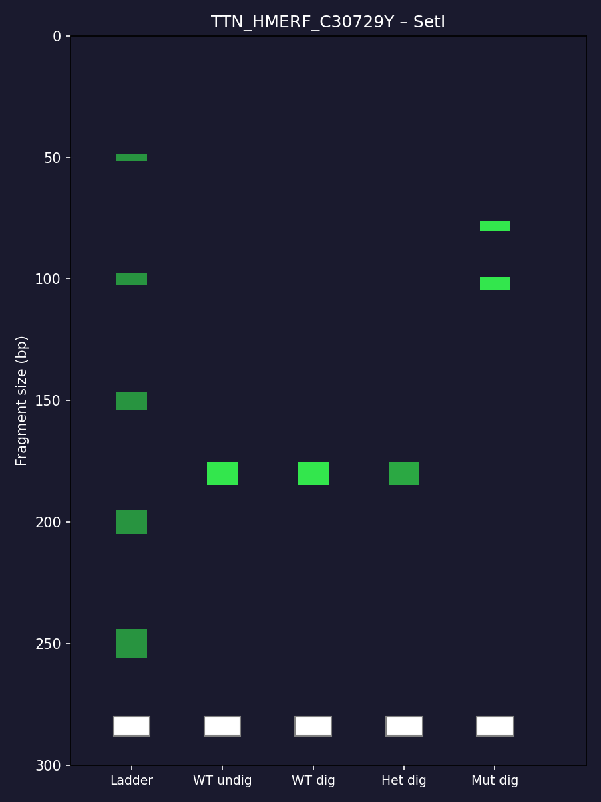
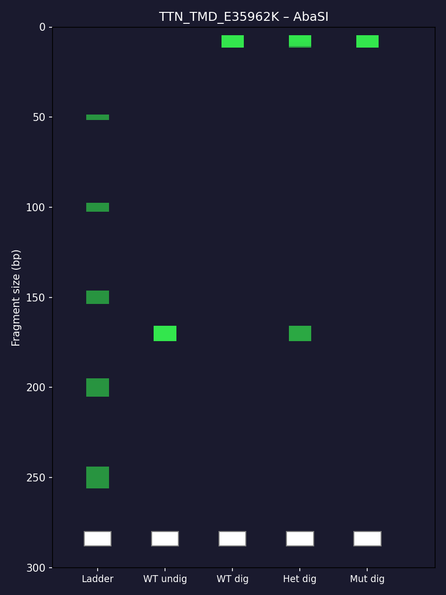

# Genotype Pipeline

Reusable local tool for designing PCR-RFLP assays for any DNA sequence + point mutation.

Given a sequence and a mutation, it automatically:
- Finds commercial restriction enzymes that cut differently in wild-type vs mutant
- Designs flanking primers (Primer3 + mismatch fallback)
- Predicts fragment sizes
- Generates a virtual gel image
- Writes Markdown, Word (.docx), and HTML reports
- Supports batch processing of multiple mutations

Designed to be reusable for any gene / any point mutation.

## Requirements

- Python 3.9 or higher
- Git

**Install all Python packages:**

```bash
pip install biopython primer3-py click pyyaml python-docx matplotlib pandas

## TTN Examples

### 1. HMERF (c.92185C>T, p.Cys30729Tyr)

**Primers (Pair 1):**
- Forward: `AGGAAAAGTAGTTGGGCCAA` (Tm=56.9°C)
- Reverse: `GTGTAACTTTGGGCTTCACA` (Tm=56.2°C)
- Product: 180 bp

**Virtual Gel:**



### 2. TMD / Udd Myopathy (c.107884A>G, p.Glu35962Lys)

**Primers (Pair 1):**
- Forward: `TCCTCCATGCAAGAGTCCTT` (Tm=58.3°C)
- Reverse: `ACTTTGCCTTCATCAATGCT` (Tm=55.9°C)
- Product: 170 bp

**Virtual Gel:**


